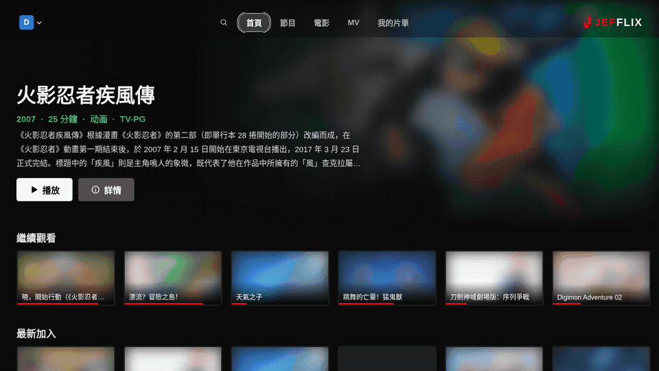
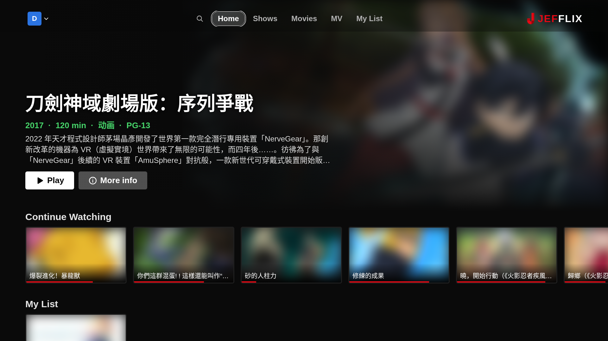
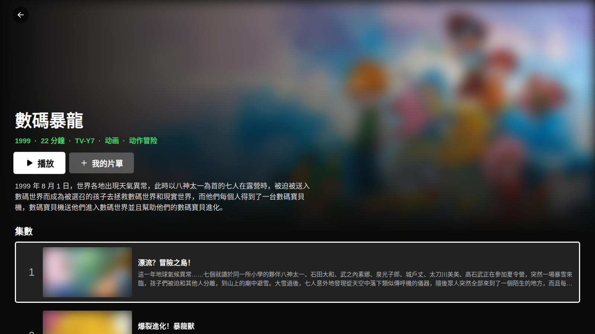
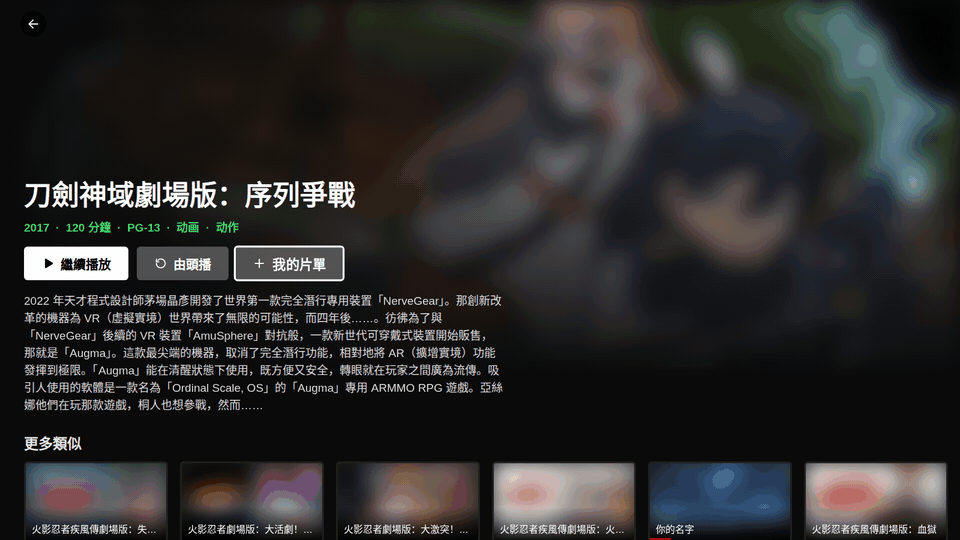
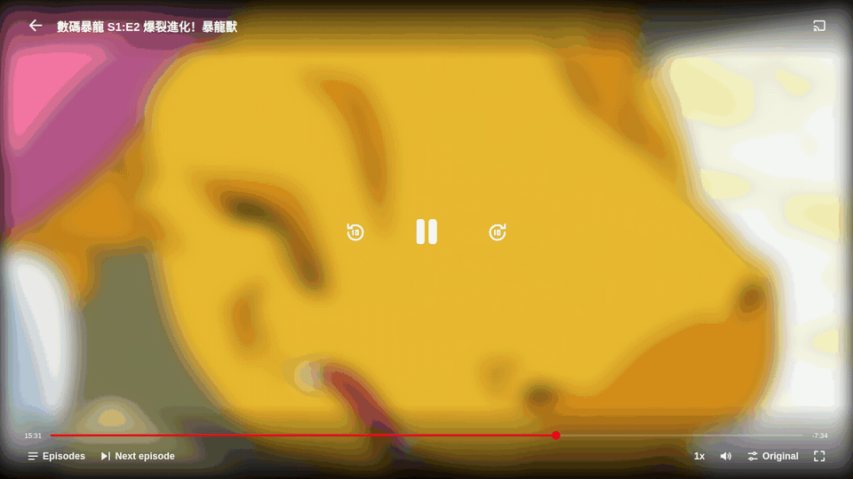
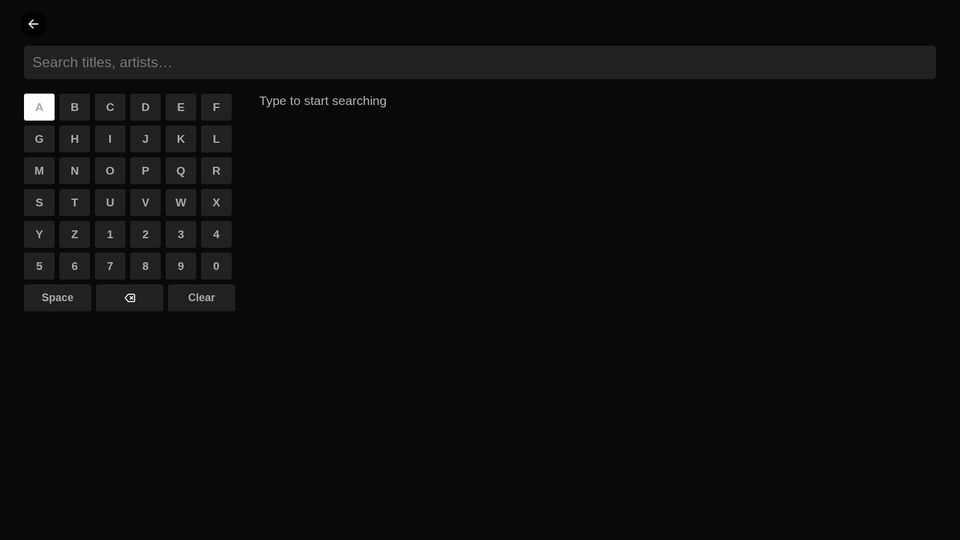
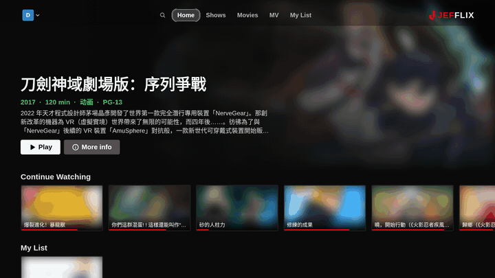
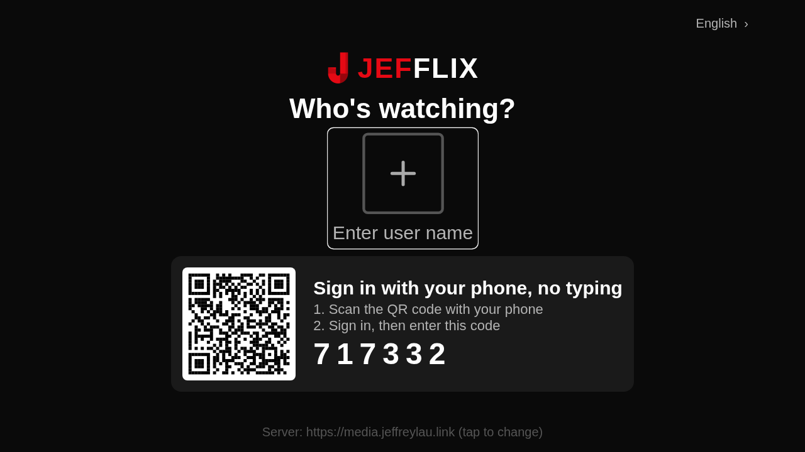

<p align="center"></p>
<h1 align="center">Jefflix</h1>

<p align="center">
  <a href="https://github.com/JeffreyLauDev/jefflix/releases/latest"></a>
  <a href="https://github.com/JeffreyLauDev/jefflix/releases"></a>
  <a href="https://discord.gg/KSp8ZRMvQP"></a>
  <a href="LICENSE"></a>
  
</p>

<p align="center"><b>Your Jellyfin, on every screen.</b><br>A cinematic home screen for the Jellyfin server you already run — on macOS, Windows, Linux, iPhone, LG TV and the web.</p>

<p align="center"><a href="https://jefflix-app.vercel.app/download/"><b>Download</b></a> · <a href="https://jefflix-app.vercel.app/docs/">Docs</a> · <a href="https://discord.gg/KSp8ZRMvQP">Discord</a> · <a href="https://jefflix-app.vercel.app">Website</a></p>


## Screenshots

> Real screens from a personal library. Artwork is blurred because it belongs to its owners; in Jefflix it is your own library, in full colour.

### Home — big hero and poster rows





### Details and My List





### The player



### Search, built for a remote



### On the TV



Sign in on the TV by scanning a QR code with your phone (Jellyfin Quick Connect):



### On iPhone

<p>
  
  &nbsp;
  
</p>

## Why Jefflix?

- **Looks like a streaming service, not a file browser.** Big hero art, poster rows, Continue Watching and Top 10, built from your own library.
- **One app on every screen.** Same look and features on Mac, Windows, Linux, iPhone, LG TV and the web.
- **Made for the couch.** Every button works with a TV remote; sign in on the TV by scanning a QR code.
- **Nothing in between.** No account, no cloud, no tracking. Jefflix talks only to your Jellyfin server.

## Download

| Platform | Get it |
| --- | --- |
| macOS 11+ (Apple Silicon + Intel) | [Jefflix_2.0.0_universal.dmg](https://github.com/JeffreyLauDev/jefflix/releases/latest/download/Jefflix_2.0.0_universal.dmg) |
| Windows 10 / 11 | [Jefflix_2.0.0_x64-setup.exe](https://github.com/JeffreyLauDev/jefflix/releases/latest/download/Jefflix_2.0.0_x64-setup.exe) |
| Linux (Debian / Ubuntu) | [Jefflix_2.0.0_amd64.deb](https://github.com/JeffreyLauDev/jefflix/releases/latest/download/Jefflix_2.0.0_amd64.deb) |
| LG TV (webOS 4+) | [com.jeffrey.jefflix_2.0.0_all.ipk](https://github.com/JeffreyLauDev/jefflix/releases/latest/download/com.jeffrey.jefflix_2.0.0_all.ipk) · [install guide](https://jefflix-app.vercel.app/docs/install/lg-webos/) |
| iPhone / iPad | TestFlight beta — [coming soon](https://jefflix-app.vercel.app/docs/install/ios/) |
| Web (self-host) | [jefflix-web-2.0.0.zip](https://github.com/JeffreyLauDev/jefflix/releases/latest/download/jefflix-web-2.0.0.zip) |

All install guides: https://jefflix-app.vercel.app/download/

## Features

- **Speaks your language:** English, 廣東話, 繁體中文, 简体中文, 日本語, 한국어, Español. Translations welcome in [`src/i18n.ts`](src/i18n.ts).

- Big hero, Continue Watching, newest additions and poster rows
- Our own player: speed, quality switch with automatic transcode fallback, episode row, next episode
- My List synced with your Jellyfin favourites
- Full remote / arrow-key navigation; on-screen keyboard search for TVs
- TV sign-in with QR code + Jellyfin Quick Connect
- No accounts, no analytics. Jefflix talks only to your server.

## Develop

Expo (React Native + web) app; desktop builds wrap the web build with Tauri.

```bash
npm install
npx expo start          # phone / web dev server
npx expo export -p web  # web build in dist/
npx tauri build         # desktop installer (needs Rust)
```

## Contributing

Ideas, bug reports and pull requests are welcome — see [CONTRIBUTING.md](CONTRIBUTING.md) and the [`good first issue`](https://github.com/JeffreyLauDev/jefflix/labels/good%20first%20issue) label. Chat with the developer on [Discord](https://discord.gg/KSp8ZRMvQP).

If Jefflix is useful to you, a star helps other Jellyfin users find it.

## Licence

MIT — see [LICENSE](LICENSE).

Jefflix is an independent, open-source project. It is not affiliated with, endorsed by or sponsored by Netflix, Inc. or the Jellyfin project. Jefflix ships no content; it plays media from a Jellyfin server you run.
